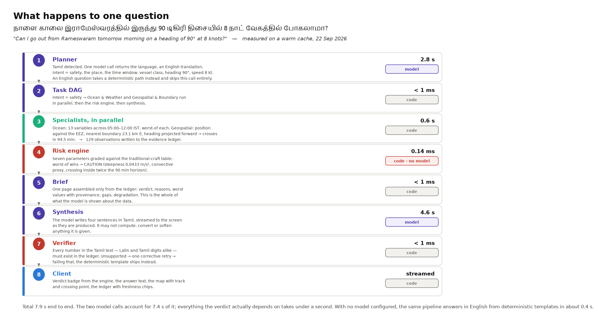

# Sagar Setu — Proposed System Architecture

*Conversational marine decision support for Indian small-craft fishermen.
ISRO/INCOIS agentic marine intelligence problem statement, Smart India Hackathon 2026.*

---

## 1. What the system does

A fisherman types a question in his own language — *"Is it safe to go out from Kochi
tomorrow morning?"*, *"Where are the fish today?"*, *"How far is the Sri Lanka boundary on
this heading?"* — and receives an answer in that same language, with a map and the
evidence behind every number in it.

The system does not forecast the sea. It applies published small-craft safety thresholds
to live government and open forecast data, and uses a language model only to understand
the question and to explain the result.

## 2. Architectural style

A **layered architecture** with a **multi-agent orchestration tier** and one
**cross-cutting data structure** (the evidence ledger). Eight layers, each depending only
on the layer beneath it.

Three principles decide every structural question in the design:

| Principle | Structural consequence |
|---|---|
| **A language model never decides whether it is safe to go to sea.** | The safety verdict is produced by a separate deterministic module (`risk/`) that has no dependency on the model layer. The model layer sits *above* it and receives its output. |
| **No number reaches the user unless it is in the evidence ledger first.** | Every tool returns `Observation` objects, never bare floats. A verifier module re-reads the drafted answer and rejects anything not traceable to a ledger row. |
| **Cache first, network second, snapshot always available.** | A single data-access chain sits between the tool belt and every external source, so all sources degrade identically and visibly. |


## 3. Component catalogue

### Layer 1 — Presentation (`web/src`, React 19 + Vite + TypeScript + MapLibre GL)

| Component | Responsibility |
|---|---|
| `App.tsx` | Session state, vessel class, submits questions, consumes the SSE stream |
| `components/Verdict.tsx` | Renders the GO / CAUTION / DO NOT SAIL badge **from the engine's result object**, never parsed from the answer text, so prose cannot soften a verdict |
| `components/MapView.tsx` | MapLibre GL map: PFZ lines, EEZ, international boundaries, vessel track, predicted crossing point. Free OpenStreetMap raster tiles — no access token to fail during a demo |
| `components/Ledger.tsx` | The evidence table: every value with source, validity time, distance to the grid node, a freshness chip and a confidence bar; cited rows highlighted first |
| `components/AgentTrace.tsx` | Live per-specialist progress and timings |
| `api.ts` | Typed client; hand-parses the SSE frame stream (`EventSource` is GET-only) |

### Layer 2 — API (`src/marine/api.py`, FastAPI)

| Endpoint | Responsibility |
|---|---|
| `POST /ask` | Runs one question and streams `agent` → `chunk` → `reset` → `result` → `done` events over Server-Sent Events, so agent progress and answer tokens appear before the request completes |
| `GET /geo/static` | EEZ outline and the 23 international boundary segments, simplified to ~1 km (228 KB instead of 3 MB) and cached in process |
| `GET /health` | Active model provider, snapshot age, the threshold tables — used by the client status bar |
| startup task | Pre-warms the PFZ advisory and the five test harbours so the first question does not pay the cold-fetch cost |

### Layer 3 — Orchestration (`src/marine/graph.py`, LangGraph)

A state machine over a typed `State`. Nodes:

| Node | Responsibility | Uses a model? |
|---|---|---|
| **Planner** (`agents/planner.py`) | Language detection, translation, intent classification, location and time-window resolution, vessel/heading/speed extraction. Emits a **typed task DAG**. A deterministic fast path handles common English questions in ~50 ms without any model call; other questions take one model call (~2.8 s). | Only on the non-fast path |
| **Ocean & Weather** (`agents/specialists.py`) | Fans out the wave/wind/visibility/sea fetches concurrently, reduces each variable to its worst value in the window, flags disagreement between sources rather than averaging them | No |
| **Geospatial & Boundary** | Position against the EEZ, nearest international boundary with bearing, PFZ bearing and distance, and the *predictive* crossing — projects heading and speed forward and warns **before** a crossing | No |
| **Analytics & Causal** | Chlorophyll against a multi-year daily baseline (z-score, trend); names a plausible mechanism as a hypothesis and never asserts causation the data cannot support | No |
| **Risk** | Calls the deterministic engine (Layer 4) | No |
| **Synthesis & Verify** (`agents/synthesis.py`) | Builds the brief, drafts the answer with the model, then verifies it | Draft only |

The three specialists are returned together by a conditional edge, so LangGraph executes
them in a single superstep — that is, concurrently. Parallelism is therefore a property of
the emitted plan, not of prompt wording.

### Layer 4 — Decision (`src/marine/risk/`) — **deterministic, no model**

| Module | Responsibility |
|---|---|
| `thresholds.py` | Three vessel-class tables (traditional < 12 m, motorised 12–20 m, mechanised > 20 m) × seven parameters: significant wave height, sustained wind with gusts, sea steepness Hs/T², visibility, lightning proximity, cyclone cone, boundary crossing. Every table carries a `CALIBRATION` string, currently `provisional`. |
| `rules.py` | `evaluate(RiskInputs, VesselClass) → RiskVerdict`. Grades each parameter, then takes the **worst** — never an average. A missing wave-height or wind value yields `insufficient_data` and can never produce GO. Returns a per-parameter breakdown with the ledger ids that produced each value. |

Runs in ~0.1 ms and is covered by 40 unit tests. It has no import from `agents/`, which
is what makes the separation structural rather than a matter of discipline.

**Synthesis & Verify** is the counterpart above the line. It builds a one-page *brief*
from the ledger — the model's entire view of the data — has the model draft the answer in
the user's language, then runs `verify()`: every number in the draft, in Latin or Indic
digits, must match a ledger value, a threshold, or a window hour. An unsupported number
triggers one corrective retry; failing that, a deterministic template answer ships instead.

### Layer 5 — Tool belt (`src/marine/tools/`)

Fifteen typed functions with Pydantic signatures — the only route by which anything,
including the agents, reaches data. A malformed call fails at the boundary rather than
becoming a wrong number in an answer.

| Module | Functions |
|---|---|
| `ocean.py` | `get_wave_forecast`, `get_wind_forecast`, `get_visibility_forecast`, `get_sea_state`, `get_chlorophyll`, `get_argo_temperature`, `fan_out` |
| `spatial.py` | `get_pfz_advisory`, `check_position`, `predict_boundary_crossing` |
| `safety.py` | `assess_sailing_risk`, `safety_briefing`, `cyclone_status`, `lightning_status` |
| `locations.py` | `resolve_location` — 5 test harbours, 16 curated ports, 1 223 INCOIS landing centres, an alias table and a deterministic Indic-script name table, with a guarded fuzzy match. Unknown names return `None`, never a guess. |
| `windows.py` | `named_window` — "tomorrow morning" → 05:00–12:00 IST → UTC |

### Layer 6 — Geospatial library (`src/marine/geo/`)

Pure functions, no I/O: `geodesy.py` (great-circle distance, bearing, destination point, a
local equirectangular projection so shapely can work in kilometres), `boundaries.py`
(EEZ point-in-polygon, nearest boundary, forward projection to the first crossing),
`pfz.py` (nearest INCOIS zone with distance, bearing and compass point).

### Layer 7 — Data access (`src/marine/sources/`)

One chain for every source: **fresh cache → live network (2 s budget) → stale cache →
frozen snapshot**, with confidence 0.95 / 1.00 / 0.70 / 0.50 respectively and a note
explaining any degradation. Also: per-source TTL and timeout, in-flight request
de-duplication (wind and visibility share one weather request), and a window-shift
fallback when the snapshot does not cover the requested hours.

### Layer 8 — External data sources

| Source | Provides | Status |
|---|---|---|
| INCOIS GeoServer WFS | Potential Fishing Zone advisory, sector polygons, 1 223 landing centres | Live, daily |
| Open-Meteo (marine + forecast) | Waves, swell, wind, gusts, visibility, SST, currents — hourly, 8 days | Live; the reliability floor of every chain |
| Copernicus Marine | Chlorophyll-a forecast plus a five-year daily baseline | Live, pre-fetched (11 s open time, so never in the request path) |
| NOAA CoastWatch | VIIRS chlorophyll, ~4 km | Live; fallback behind Copernicus |
| Marine Regions (VLIZ) | EEZ polygon, 23 international boundary segments | Static, committed to the repository |
| INCOIS ERDDAP (Argo) | Gridded temperature, 1° | Live but ~6 weeks stale — weak cross-check only |
| IMD | Cyclone track and cone, lightning, district warnings | **Blocked** — institutional API key pending. Reported as an explicit gap in every verdict rather than silently omitted. |

### Cross-cutting — the evidence ledger (`src/marine/ledger.py`)

Not a layer but a structure threaded through all of them.

```python
class Observation(BaseModel):
    variable: str          # "significant_wave_height"
    value: float
    unit: str              # "m"
    source: str            # "open_meteo/marine"
    valid_time: datetime   # when the value is FOR
    fetched_at: datetime   # when we got it
    distance_km: float     # query point → nearest grid node
    confidence: float      # lowered when we fell down the chain
    note: str | None       # "served from snapshot, network unavailable"
    provenance: Literal["live", "cache", "stale_cache", "snapshot"]
```

`MissingObservation` records a variable we tried to obtain and could not, with the reason,
so the answer can say *"I could not check cyclone warnings"* instead of quietly dropping
the parameter. The ledger serves three consumers: the risk engine reads the worst value
per parameter from it; the brief given to the model is built only from it; and the
verifier rejects any number in the answer that is not in it.

## 4. How the components interact



The measured path for one Tamil question, on a warm cache: planner 2.8 s → task DAG
< 1 ms → two specialists in parallel 0.6 s (129 observations written to the ledger) →
risk engine 0.14 ms → brief < 1 ms → synthesis 4.6 s streamed → verifier < 1 ms → client.
Total 7.9 s, of which 7.4 s is the two model calls. An English question skips the planner
call. With no model configured, the same pipeline answers in English from deterministic
templates in about 0.4 s.

**Control flow** is downward through the layers; **data flow** returns upward, but only
after passing through the ledger and the verifier. There is no path by which the model
layer can write a value into a verdict.

## 5. Key design decisions

| Decision | Alternative rejected | Reason |
|---|---|---|
| Deterministic rule engine for the verdict | An ML classifier or letting the model decide | No labelled dataset of small-craft outcomes exists; a safety verdict must be auditable line by line; and thresholds belong to INCOIS/IMD, not to us |
| Worst-of combination, never a weighted average | Utility function over the seven parameters | Averaging is how a system sends someone out under a thunderhead because the waves were calm |
| Evidence ledger + verifier | Trusting the model's output, or post-hoc fact-checking | Makes hallucination structurally impossible for numeric claims rather than merely unlikely |
| Four agents (planner + three specialists + synthesis) | The nine roles listed in the problem statement as nine processes | Those are capabilities, not processes; a nine-agent chain costs ~40 s and looks broken. Missing capabilities go into the tool belt as ordinary Python |
| Model behind a provider interface | Hard-coding one vendor's SDK | The model does only language work, so it is swappable by configuration (Gemini free tier by default; Ollama for offline; Anthropic optional). Total project cost stays at zero |
| Deterministic fast path in the planner | Every question through the model | Keeps common English questions at ~50 ms of planning on a free tier whose round trip is ~2.8 s |
| Consume INCOIS's PFZ product | Train a fishing-zone model | INCOIS has two decades of validation against catch data; our contribution is reasoning over it |
| Snapshot fallback committed to the repository | Requiring connectivity | The system must give a complete, honestly-labelled answer with the network unplugged |

## 6. Non-functional properties

- **Latency.** Target ≈ 2.4 s to first token. Achieved for English (~0.4 s deterministic, ~3.6 s with the model); Indic-script questions run ~8 s on the free model tier. Mitigations in place: the planner fast path, pre-warmed caches, concurrent fan-out, and token streaming so the answer appears as it is written.
- **Degradation.** Four-step fallback per source; provenance and confidence surfaced to the interface; missing feeds named explicitly in the answer.
- **Testability.** 115 tests, none requiring the network or a model: the risk engine and geo library have real unit tests; agent behaviour has smoke tests with a scripted fake model, including one that invents numbers to prove the verifier catches it.
- **Cost.** Every data source is free; the model runs on a free tier; hosting is a laptop. Nothing in the architecture requires paid infrastructure.
- **Evaluation.** A separate harness (`src/marine/eval/`) scores the verdict from yesterday's forecast against the analysis of what the morning actually brought — 460 harbour-mornings — plus a prospective daily log. Day-ahead do-not-sail warnings: 94 % hit rate, 3 % false-alarm ratio.

## 7. Deployment view

Two processes on one machine for the demo:

```
uv run uvicorn marine.api:app --reload      # API + orchestration + engine, port 8000
cd web && npm run dev                       # interface, port 5173
```

`data/static/` (boundaries, sectors, landing centres) and `data/snapshots/` (a week of
real data for five harbours) are committed, so a clone runs offline. `data/cache/` is
local and gitignored. The only configuration is a `.env` file, and every key in it is
optional.

---

*Code: `github.com/harshvsinghnorth/sagar-setu` · 4 748 lines of Python, 629 of
TypeScript, 115 tests. Diagrams regenerate with `uv run python scripts/plot_architecture.py`.*
