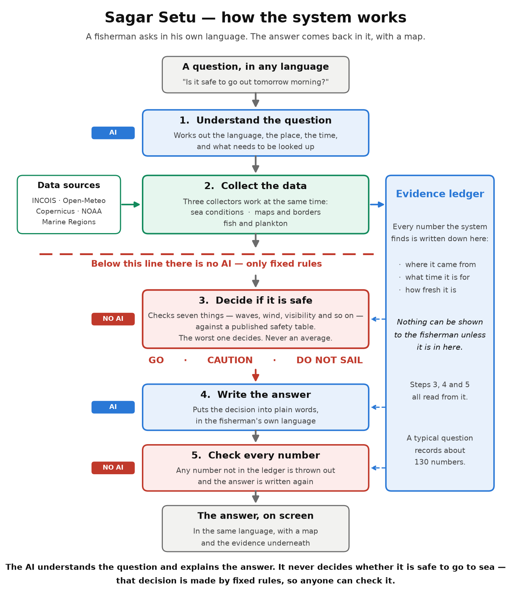
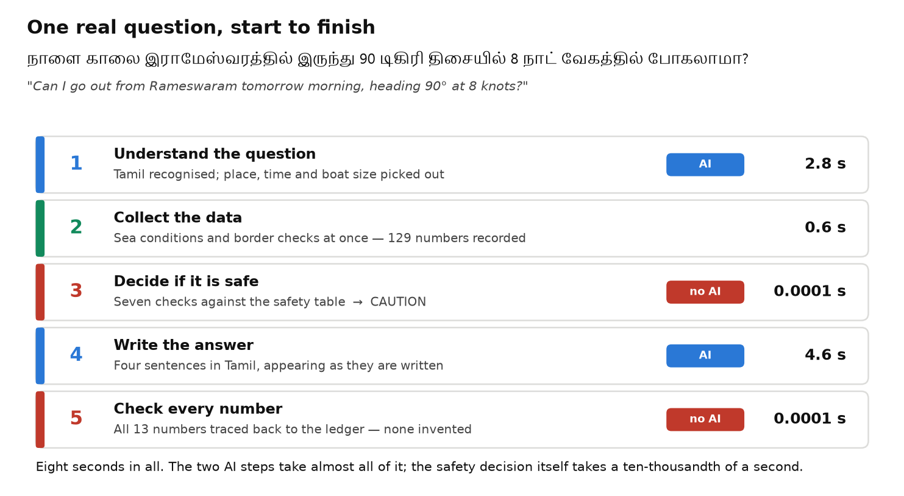

# Sagar Setu — proposed system architecture

Marine decision support for Indian small-craft fishermen.
ISRO / INCOIS problem statement · Smart India Hackathon 2026.

> This is the short version, written to be read in five minutes.
> The full technical breakdown — every module, every schema, every rejected
> alternative — is in [architecture-detailed.md](architecture-detailed.md).

---

## 1. What the system does

A fisherman types a question in his own language — *"Is it safe to go out from Kochi
tomorrow morning?"*, *"Where are the fish today?"*, *"How far is the Sri Lanka border on
this heading?"* — and gets an answer in that same language, with a map, and with the
source of every number shown underneath.

**The system does not predict the weather itself.** It collects official forecasts and
fishing-zone advisories, applies a fixed safety table to them, and uses AI only to
understand the question and to explain the result in plain words.

---

## 2. The main idea

Three rules shape the whole design.

- **AI never decides whether it is safe to go to sea.** The decision comes from a fixed
  safety table — the kind a harbour master would use. AI sits outside that decision,
  before it and after it.
- **No number is shown unless it was recorded first.** Every value the system collects
  goes into an evidence ledger, with where it came from and how old it is. A checking
  step removes any number in the answer that is not in the ledger.
- **The system always answers, and always says how good its data is.** If a source is
  slow or down, it falls back to a stored copy — and says so.

---

## 3. The architecture



*Figure 1 — the main components and how they connect.*

---

## 4. The parts of the system

| Component | What it does |
|---|---|
| Web page | Where the fisherman types the question and sees the answer, the map and the evidence table |
| Server | Connects the web page to everything else, and sends the answer back a few words at a time so it appears as it is written |
| **1. Understanding** (AI) | Works out the language, the place, the day and time, and the size of the boat — then decides what needs to be looked up |
| **2. Collectors** (three, at the same time) | One fetches sea conditions, one checks maps and borders, one looks at fish and plankton data. They run together, not one after another |
| **Evidence ledger** | The record of every number collected: its value, where it came from, what time it is for, how fresh it is, and how much it can be trusted |
| **3. Safety rules** (no AI) | Checks seven things — wave height, wind, visibility and so on — against a safety table for that size of boat. The worst one decides the answer |
| **4. Answer writer** (AI) | Turns the decision into a few plain sentences in the fisherman's own language |
| **5. Checker** (no AI) | Reads the answer and throws out any number that is not in the ledger. If it finds one, the answer is written again |
| Data sources | INCOIS (fishing zones), Open-Meteo (waves and wind), Copernicus and NOAA (plankton), Marine Regions (sea borders). IMD's cyclone and lightning data is pending an access key |

---

## 5. How the parts work together

The question travels down through the parts in order; the answer comes back up. The
collectors run at the same time as each other rather than one after another, which is what
keeps the system fast.



*Figure 2 — one Tamil question, measured end to end on 22 September 2026.*

**Eight seconds in all.** The two AI steps take almost all of it. The safety decision
itself takes a ten-thousandth of a second, because it is only a table lookup. An English
question is faster — about four seconds — because step 1 does not need AI. With AI
switched off completely, the system still answers in English in under half a second.

---

## 6. Why it is built this way

| Choice | Reason |
|---|---|
| The safety decision uses fixed rules, not AI | Anyone can read the table and check the answer. A wrong answer here could cost a life, and there is no dataset of "boats that did and did not come back" to train such a model on anyway |
| The worst reading decides, never an average | Averaging is how a system tells someone to go out under a thunderstorm because the waves happened to be calm |
| Every number is recorded before it is used | This makes it impossible for the AI to invent a number, rather than merely unlikely — the checker removes anything not in the ledger |
| We use INCOIS's fishing zones rather than predicting our own | INCOIS has twenty years of validation against real catch data. Our contribution is reasoning over their advisory, not replacing it |
| A stored copy of the data is kept in the system | The system must still give a complete, honest answer when the network is down — and say that is what it is doing |

---

## 7. What runs where

Two programs on one computer:

```bash
uv run uvicorn marine.api:app --reload       # the server and all the logic
cd web && npm run dev                        # the web page
```

Everything is free: every data source, the AI service (free tier), and the hosting, which
is a laptop. The sea borders and a week of stored data live inside the project, so a fresh
copy works with no internet connection at all.

**Built so far:** all five steps above are working, with 115 automatic tests.

---

### Figures

| File | What it is |
|---|---|
| `architecture/architecture.png` | Figure 1 above — the simple component diagram |
| `architecture/flow.png` | Figure 2 above — one question, measured |
| `architecture/architecture_detailed.png` | The full eight-layer module diagram, for the technical appendix |
| `architecture/request_flow_detailed.png` | The same request broken into eight steps with per-module timings |

Regenerate with:

```bash
uv run python scripts/plot_architecture_simple.py   # figures 1 and 2
uv run python scripts/plot_architecture.py          # the detailed pair
```
