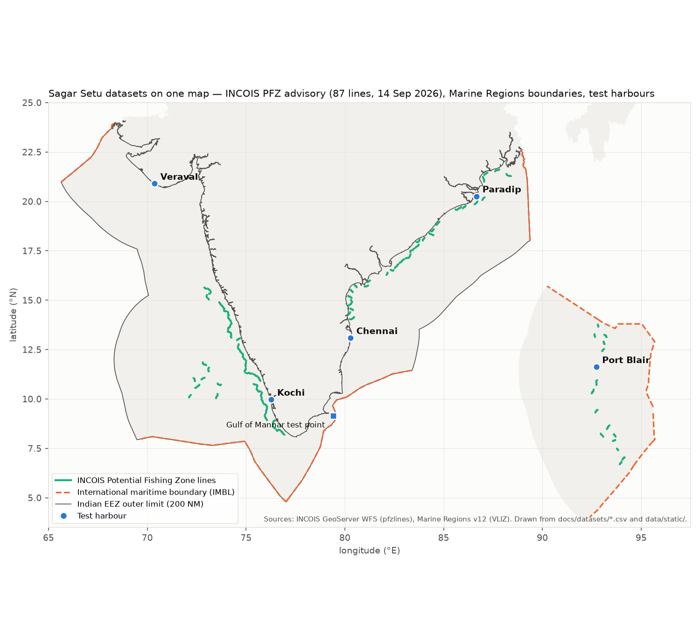
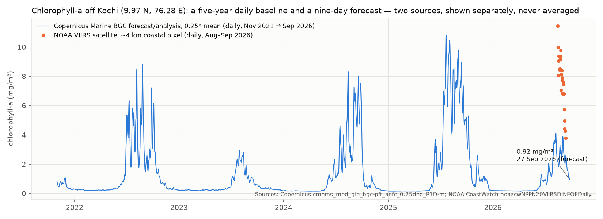

# Sagar Setu — Datasets

*Prepared 18 Sep 2026 for the project review. Every dataset below has been fetched live
from this machine; the sample files in `docs/datasets/` are extracts of real responses,
not illustrations. Verification details and request shapes are in `data-sources.md`.*

---

## 1. The idea, in one paragraph

Small-craft fishermen on the Indian coast make a life-or-death decision every morning —
whether to go out — and a livelihood decision — where to go — with information that is
scattered across half a dozen government and international sources, most of it in English
and none of it conversational. Sagar Setu lets a fisherman ask in Tamil, Hindi or English
("Is it safe to go out from Kochi tomorrow morning?", "Where are the fish today?", "How far
is the Sri Lanka line on this heading?") and answers in the same language, with a map and
the evidence behind every number. The system does not predict anything itself: it fetches
official data, applies a deterministic, published-threshold safety rulebook, and uses a
language model only to understand the question and explain the result.

**The data principle that shapes everything:** no number reaches the user unless it is in
an *evidence ledger* with its source, the time it is valid for, the distance from the
user's position to the nearest data point, and how fresh it is. If a source is missing,
the system says so. It never fills a gap with a guess.

---

## Figures (drawn from the sample files, nothing synthetic)



*INCOIS's 87 PFZ lines for 14 Sep 2026 (green), the international maritime boundaries
(orange dashed), the EEZ outer limit, and the five test harbours. Note the empty Tamil
Nadu, Gujarat and Maharashtra coasts — no advisory was issued for those sectors that day.*



*Copernicus daily chlorophyll off Kochi, Nov 2021 → Sep 2026: the south-west-monsoon
upwelling bloom recurs every June–September, and the 2026 bloom is markedly weaker than
2022, 2024 and 2025. The orange points are the NOAA VIIRS coastal pixel for Aug–Sep 2026 —
several times higher, because a 4 km coastal pixel and a 0.25° offshore mean measure
different water. We show both and say so; we do not average them.*

## 2. Dataset catalogue

| # | Dataset | Publisher | What it gives us | Role | Status |
|---|---|---|---|---|---|
| 1 | Potential Fishing Zone advisory | INCOIS (MoES, Govt of India) | Daily lines where fish are likely, per coastal sector | Where to fish | **Live**, verified |
| 2 | Marine forecast (waves, swell, SST, currents) | Open-Meteo (open data, aggregates ECMWF/MeteoFrance wave models) | Hourly, 8 days ahead | Safety verdict inputs | **Live**, verified |
| 3 | Weather forecast (wind, gusts, visibility, CAPE) | Open-Meteo | Hourly, 8 days ahead | Safety verdict inputs | **Live**, verified |
| 4 | Chlorophyll-a forecast + 5-year history | Copernicus Marine (EU) | Daily, 0.25°, 2021 → +9 days | Productivity / anomaly analysis | **Live**, verified (free account) |
| 5 | Chlorophyll-a satellite (VIIRS) | NOAA CoastWatch | Daily, ~4 km, near-real-time | Fallback for #4 | **Live**, verified |
| 6 | Exclusive Economic Zone + maritime boundaries | Marine Regions (Flanders Marine Institute) | Polygons and boundary lines incl. India–Sri Lanka | Geofencing | **Static**, committed |
| 7 | Fish landing centres | INCOIS | 1,223 named landing centres with district and sector | Place-name resolution | **Static**, committed |
| 8 | PFZ sector polygons | INCOIS | 14 coastal sectors | Sector lookup | **Static**, committed |
| 9 | Argo gridded temperature | INCOIS ERDDAP | 10-day, 1° grid | Weak cross-check on SST | Live but stale (6 weeks) |
| 10 | Cyclone track / cone, lightning, district warnings | IMD | Official warnings | Two of six risk parameters | **Blocked** — API key pending |

Everything above is free. The project has no paid data dependency.

---

## 3. Dataset cards

Each card: what it is, why we need it, exactly what we take, its limits, and the sample
file you can open.

### 3.1 INCOIS Potential Fishing Zone (PFZ) advisory

- **Publisher:** Indian National Centre for Ocean Information Services, Hyderabad
  (Ministry of Earth Sciences). The PFZ product is operational since the 1990s and
  validated against catch data; it is the same advisory disseminated to fishermen by SMS,
  radio and notice boards.
- **How it is made (by INCOIS, not us):** sea-surface temperature and chlorophyll from
  satellites (NOAA AVHRR, Oceansat OCM) are combined to locate thermal fronts and
  productive water; the fronts are drawn as lines and published per sector, in ten
  languages.
- **How we access it:** INCOIS's own web map (`incois.gov.in/geoportal/MFASPFZ`) is driven
  by a GeoServer WFS endpoint. We call the same endpoint and receive the day's lines as
  GeoJSON. It is undocumented but public and it is what INCOIS's website itself uses.
- **What we take:** every line's geometry (a `MultiLineString`), the state/sector, and the
  advisory date (year + Julian day). We compute bearing and distance from the fisherman's
  harbour to the nearest line ourselves (great-circle geometry).
- **Coverage on 15 Sep 2026:** 87 lines across Kerala (21), Andhra Pradesh (22),
  Karnataka (10), Lakshadweep (8), Nicobar (8), Andaman (7), Orissa (6), Goa (3), West
  Bengal (2). **No lines for Tamil Nadu, Gujarat or Maharashtra that day** — the system
  must say "no advisory for your sector today", not invent one.
- **Cadence:** daily, typically for the previous day's satellite pass. Not issued during
  cloud cover or the fishing ban period.
- **Limits:** the depth/catch text advisory is not exposed through this endpoint, only the
  geometry. A separate landing-centre layer carries bearing/distance fields, but they are
  frozen at 27 April 2024 — we discovered this and do not use them.
- **Rule we follow:** consume, never reimplement. We do not train a model to predict fishing
  zones; INCOIS has two decades of validation we cannot match.
- **Sample files:** `incois_pfz_lines.csv` (one row per line), `incois_pfz_vertices.csv`
  (42,740 vertices for plotting).

### 3.2 Open-Meteo Marine forecast

- **Publisher:** Open-Meteo (open-source weather API, Switzerland). Marine variables come
  from MeteoFrance's MFWAM wave model and ECMWF; SST and currents from global ocean models.
  Free for non-commercial use, no key, CC-BY 4.0.
- **Why this and not INCOIS's own ocean forecast:** INCOIS's ERDDAP server hosts no current
  wave/wind fields (see §4). Open-Meteo answers in ~300 ms from any connection, which is
  why it is the *reliability floor*: every other source falls back to it.
- **What we take, hourly, 8 days ahead:** significant wave height, wave period and
  direction, swell height/period/direction, wind-wave height/period, sea-surface
  temperature, ocean-current speed and direction.
- **Resolution:** ~5 km grid for waves. The response tells us the grid node it actually
  used — Kochi harbour snaps to a node 8 km away — and we record that distance in the
  ledger.
- **Limits:** a global model, not tuned to the Indian coast; no tide in the variables we
  currently pull (available; planned). Currents arrive in km/h and are converted to knots.
- **Sample files:** `open_meteo_marine_hourly.csv` (2,160 hours: 6 points × 15 days),
  `open_meteo_marine_units.csv`.

### 3.3 Open-Meteo Weather forecast

- **Publisher:** as above; atmospheric variables from national weather models (ECMWF IFS,
  DWD ICON, etc.), best available per region.
- **What we take, hourly, 8 days ahead:** 10 m wind speed and gusts (requested in knots),
  wind direction, visibility, precipitation, WMO weather code, CAPE (convective energy).
- **Why CAPE and weather codes:** we have no lightning feed until IMD grants access.
  Thunderstorm weather codes (95–99) and CAPE ≥ 2000 J/kg serve as a clearly-labelled
  *convective proxy* in the safety check — shown as a proxy, never as lightning data.
- **Sample files:** `open_meteo_weather_hourly.csv`, `open_meteo_weather_units.csv`.

### 3.4 Copernicus Marine — chlorophyll-a (biogeochemistry)

- **Publisher:** Copernicus Marine Service (European Union), produced by Mercator Ocean
  International. Free account required; we hold one.
- **Dataset:** `GLOBAL_ANALYSISFORECAST_BGC_001_028`, daily means,
  `cmems_mod_glo_bgc-pft_anfc_0.25deg_P1D-m`, variable `chl` (mg/m³).
- **Coverage verified:** **1 Nov 2021 → 25 Sep 2026** in one dataset — a nine-day forecast
  and a five-year daily history. This is what the "why is the catch declining?" analysis
  needs: today's value against a multi-year baseline for the same place and season.
- **Resolution:** 0.25° (~28 km). Coarser than VIIRS but model-continuous (no cloud gaps)
  and forward-looking.
- **Limits:** a model product; near the coast it can differ from satellite retrievals
  (Kochi: ~1.0 mg/m³ from Copernicus vs 3–4 mg/m³ from VIIRS at the coastal pixel). Our
  Ocean agent's rule is to *show both with their distances and flag the disagreement*, never
  to average them. Opening the remote dataset takes ~11 s, so it is pre-fetched into a
  cache, never called in the request path.
- **Sample files:** `copernicus_chlorophyll_forecast.csv` (6 points × 89 days, July →
  25 Sep 2026), `copernicus_chlorophyll_kochi_2021_2026.csv` (1,792 daily values).

### 3.5 NOAA CoastWatch — VIIRS chlorophyll-a

- **Publisher:** NOAA CoastWatch (USA), from the VIIRS instrument on Suomi-NPP and
  NOAA-20, gap-filled by DINEOF. Open, no account.
- **Dataset:** `noaacwNPPN20VIIRSDINEOFDaily`, ~4 km, daily, about 3 days behind real time.
- **Role:** the no-account fallback behind Copernicus in the chlorophyll chain, and a
  finer-resolution satellite check near the coast.
- **Sample file:** `noaa_viirs_chlorophyll.csv` (6 points, 15 Aug → 12 Sep 2026).

### 3.6 Marine Regions — EEZ and maritime boundaries

- **Publisher:** Flanders Marine Institute (VLIZ), Belgium — the standard global reference
  for maritime boundaries, used by FAO, UNEP and OBIS. CC-BY.
- **What we take:** the Indian EEZ polygon (MRGID 8480, 1.66 million km², mainland +
  Andaman & Nicobar), the EEZ + land union polygon, and every boundary line where India is
  a party. Of the 32 line features, 23 segments are actual international boundaries
  (`Treaty`, `Median line`, `Court ruling`) — India–Sri Lanka, –Maldives, –Pakistan,
  –Bangladesh, –Myanmar, –Thailand, –Indonesia. The rest (200 NM limits, straight
  baselines, connection lines) are excluded from geofencing.
- **Why it matters:** the India–Sri Lanka line through Palk Bay and the Gulf of Mannar is
  where Tamil Nadu fishermen are detained every year. We test geofencing there, including
  the *predictive* version: project the boat's heading 90 minutes ahead and warn before the
  crossing.
- **Sample files:** `marine_regions_boundaries.csv`, `marine_regions_eez_polygon.csv`.

### 3.7 INCOIS landing centres and PFZ sectors

- **Publisher:** INCOIS, from the same GeoServer.
- **What we take:** 1,223 landing centres (name, district, sector, lat/lon) and 14 sector
  polygons. The landing centres are our place-name resolver — "Vypeen", "Kasimedu",
  "Tuticorin" → coordinates and sector — so we need no commercial geocoding API.
- **Limits:** some major harbours (Rameswaram, Kasimedu) are absent; we added 16 by hand
  from charts. Spellings are inconsistent (transliteration); we resolve with aliases and a
  guarded fuzzy match.
- **Sample files:** `incois_landing_centres.csv`, `incois_pfz_sectors.csv`.

### 3.8 INCOIS ERDDAP — Argo gridded temperature

- **Publisher:** INCOIS, from Argo profiling floats, objectively analysed onto a 1° grid
  every 10 days.
- **Status:** live, but the latest field is 30 July 2026 (six weeks old at verification)
  and coastal cells are empty. Kept as a coarse cross-check; the ledger shows its distance
  (~50 km) and age so it can never masquerade as a forecast.
- **Sample file:** `incois_argo_temperature.csv`.

---

## 4. Datasets we evaluated and could not use (and why)

A dataset section is only credible if it includes what was rejected.

| Dataset | Finding | Consequence |
|---|---|---|
| **INCOIS ERDDAP gridded products** (SST, winds, chlorophyll) | Reachable, but stale: ASCAT winds end May 2023, OCM chlorophyll ends 2006, AVHRR SST ends 2011, AMSR2 has a broken time axis. Only Argo is current. | Open-Meteo carries the live forecast role the brief had assigned to INCOIS. The old fields may serve as climatology later. |
| **IMD API** (`api.imd.gov.in/api/v1/*`: cyclone track, cone of uncertainty, lightning, district warnings, coastal bulletin, port warnings) | Every endpoint returns `401 API key missing`. Registration requires a signed letter from the head of the institute. | Cyclone and lightning — two of the six risk parameters — have no live feed. The rules are implemented and tested; the verdict lists them as gaps. Application in progress. |
| **IMD public API** (`mausam.imd.gov.in/api/*`) | Requires IP whitelisting. | Same. |
| **INCOIS landing-centre advisory fields** (bearing, distance, depth) | Present in the layer but every record is dated 27 April 2024 — frozen. | Not used. We compute bearing/distance from live geometry instead. |
| **Bhashini** (Government of India translation/ASR) | Needs developer keys; approval takes days. | Language round-trip currently uses the Gemini model (verified in Tamil and Hindi); Bhashini will be plugged in when keys arrive. |

---

## 5. How the data flows

```
question (any language)
   │
   ▼
Planner ── resolves place name (dataset 7) and time window; classifies intent
   │
   ├─► Ocean & Weather ── Open-Meteo marine + weather (2, 3) ──┐
   ├─► Geospatial ──────── PFZ (1), EEZ/IMBL (6), heading projection ─┼─► evidence ledger
   └─► Analytics ───────── Copernicus (4) → VIIRS (5) chlorophyll ────┘
                                    │
                                    ▼
                     Risk engine — deterministic rules, no model
                                    │
                                    ▼
                     Answer in the user's language; every number checked
                     against the ledger before it is shown
```

Every fetch follows the same chain: fresh cache → live network (2-second budget) →
stale cache → frozen snapshot. The snapshot (`data/snapshots/`, a week of real data for
five harbours) means the system gives a complete, honestly-labelled answer with the
network unplugged. `fetch_manifest.csv` records the URL, status and latency of every call
that built it.

---

## 6. Open questions we would value guidance on

1. **Threshold calibration.** Our go / caution / do-not-sail bands (e.g. wave height
   1.5 m / 2.5 m for craft under 12 m) are starting values. We are looking for INCOIS's
   published small-craft / High Wave Alert criteria and IMD's fishermen-warning criteria
   to cite. Any pointer to the official document would let us replace "provisional" with
   "as published by INCOIS".
2. **Copernicus vs VIIRS chlorophyll near the coast** differ by 3×. Is there a preferred
   product for the Indian shelf in the literature, or a known coastal bias correction?
3. **IMD access.** If the department has a channel to IMD or INCOIS, it would unlock the
   cyclone and lightning parameters, which are the ones most relevant to the Bay of Bengal
   harbours.
